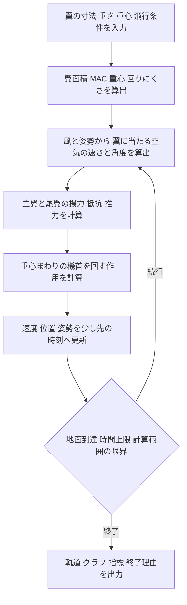

# 航空機シミュレーターの計算の仕組み

[数値と飛行の変化を学ぶ教材](learning-guide.md)

AeroLabは、入力した翼・重さ・重心・投げ方から、その瞬間にかかる力を求め、速度と姿勢を少しずつ更新して飛行経路を計算します。飛距離を決まった倍率で増減させる仕組みではなく、揚力・抵抗・重力・機首の回転が互いに影響した結果として距離が決まります。

対象はアプリ v0.3.0、計算モデル `3dof-naca-1.1` です。専門用語には意味を添え、後半に実装と対応する式をまとめています。

## 計算全体の流れ

入力 → 面積と重心の算出 → 風と迎角の算出 → 力とモーメントの計算 → 位置と姿勢の更新 → 終了条件の確認、の順に進めます。終了まで、風と迎角の算出以降を繰り返します。

再現する動きは、前後・上下への移動と、機首を上げ下げする回転です。これを縦方向3自由度と呼びます。毎時刻、水平位置・高さ・前後速度・上下速度・機首角度・機首の回転速度の6つを追跡します。左右の旋回、横滑り、翼が左右に傾く動きは計算しません。

## 形と重さから計算の土台を作る

### 翼面積とMAC

主翼は、左右対称で前縁が一直線の台形翼として扱います。翼幅、翼根の前後長さ、翼端がどれだけ細いかを表すテーパー比から、翼面積を求めます。

MACは、前後長さが場所によって違う翼を、空力計算用の代表的な長さで表したものです。重心を「30% MAC」と入力すると、このモデルでは主翼前縁からMACの30%だけ後ろにある位置になります。

ARは翼の細長さです。同じ面積なら、左右に長い翼ほどARが大きくなります。テーパー比の変更は面積・MAC・ARを通じて計算に反映されますが、翼端からの失速の始まり方や、翼幅方向の細かな力の分布は求めていません。細くすれば常に良く飛ぶ、という計算にはなりません。

### 重心と回りにくさ

CGは重心です。シーソーの支点のように、機体が機首を上げ下げする回転の基準になります。

「直接入力」では、総質量、重心、Iyyをそれぞれ指定します。Iyyは機首を上下に回すときの回りにくさで、大きいほど同じ力でも回転速度が変わりにくくなります。総質量だけを変えても、重心とIyyは自動では変わりません。

「部品から算出」では、部品の重さと配置から総質量と重心を求めます。Iyyには各部品自身の回りにくさと、部品が機体の重心から離れている効果を足します。機首に重りを追加すると、重さ・重心・Iyyが同時に変わります。

## 空気の速さと翼に当たる角度を求める

### 対地速度と対気速度

地面から見た速さが対地速度、空気に対する速さが対気速度です。揚力と抵抗の計算には対気速度を使います。

風は水平方向に一定とし、追い風をプラス、向かい風をマイナスで入力します。地面に対する速度から風の速度をベクトルとして差し引きます。水平に9m/sで投げ、3m/sの追い風なら対気速度は6m/sです。風を差し引く処理は1回です。

このsimの初速度入力は対地速度です。同じ初速度で追い風だけを強めると、地面から見た投げる速さは同じでも、初めに翼へ当たる空気は遅くなります。

### 機首角度と迎角

機首角度は機体が向いている方向、投射角は投げる速度の向きです。迎角は、翼と、その場所へ来る空気の向きの差です。

無風で初期回転がない場合、機体の迎角は「機首角度 − 投射角」です。主翼の迎角にはさらに主翼取付角を加えます。機首角度3°、投射角3°、主翼取付角2°なら、初期の主翼迎角は2°です。

飛行中は機首の回転により、主翼と尾翼の位置で空気の当たり方が変わります。この局所的な速度も計算します。尾翼では、主翼が後方の空気を下向きに曲げる「吹き下ろし」を差し引きます。

## 揚力と空気抵抗を計算する

### 揚力は速さの二乗と翼面積に比例する

揚力は、空気の密度、対気速度の二乗、翼面積、揚力係数CLから求めます。CLは、翼の角度や翼型から決まる「揚力の出やすさ」です。

他の条件とCLが同じなら、対気速度を2倍にすると揚力は4倍になります。ただし、飛行中は速度と姿勢が変わるため、飛距離が4倍になるという意味ではありません。

CLは、小さい迎角では角度にほぼ比例する式で求めます。細長さARと翼効率eで、有限の長さを持つ翼の効果を近似します。CLには入力したCLmaxで上限と下限を設けます。これは計算値を抑える処理であり、実際の失速後の流れを再現するものではありません。

### NACA翼型が計算に反映される部分

NACAモードでは、翼の反りを表す中心線から、薄翼理論で次の2つを求めます。

- 零揚力角：揚力がゼロになる主翼迎角。

- Cm₀：主翼自身が持つ、機首を上げ下げしようとする作用の係数。

例えばNACA 2412に相当する反り2%、反り位置40%、厚み12%では、零揚力角は約−2.077°、Cm₀は約−0.05312です。このモデルでは、反りを変えると揚力だけでなく機首を回す作用も変わります。

**翼厚は形状表示に使いますが、現在の空力計算には入りません。** 厚さだけを変えて他を固定した場合、軌道は同じです。NACA番号から実測の性能表を読み込む処理や、XFOIL・CFDによる解析はありません。係数手入力モードでは、入力した零揚力角とCm₀を使います。

### 抵抗は主翼と尾翼と胴体の合計

| 抵抗の種類 | このsimでの計算 | 読み取り方 |
| --- | --- | --- |
| 主翼と尾翼の基礎抵抗 | 動圧×面積×基礎抗力係数 | 表面や翼型に由来する抵抗を、指定係数でまとめて近似します。主翼はCD₀を入力し、尾翼は0.015固定です。 |
| 揚力に伴う抵抗 | CL²とAR、翼効率eから近似 | 同じCLと動圧と面積で比べるなら、ARやeが大きいほどこの抵抗は小さくなります。 |
| 胴体の抵抗 | 動圧×胴体CdA | CdAは抵抗係数×基準面積をまとめた値です。 |

大迎角では数値計算を継続するための追加抵抗も入りますが、失速後の性能予測に使える精度はありません。

胴体を鉛筆のように尖らせても、表示形状からCdAを自動計算する仕組みはありません。実機では抵抗が変わる可能性がありますが、このsimで比較するには、その変化に対応するCdAを別途見積もって入力する必要があります。翼の積層痕や表面の粗さも自動では評価しません。

## 尾翼と推力から機首の動きを求める

### 尾翼は後ろの小さな翼として計算する

尾翼にも主翼と同じ形式の揚力・抵抗の式を使います。尾翼の迎角は、局所的な空気の向き、尾翼取付角、昇降舵角、主翼の吹き下ろしから求めます。昇降舵の効きは、入力角度の55%を尾翼迎角へ足す簡易モデルです。

尾翼効率は尾翼で使う動圧に掛けます。尾翼の零揚力角は0、CLの上限は±1.0固定です。尾翼の力は上向きにも下向きにもなり、重心の後方で働くことで機首の動きに影響します。

### 力の大きさと働く位置を合わせて考える

同じ力でも重心から離れた位置で働くほど、機首を回す作用が大きくなります。この作用をピッチモーメントと呼びます。

主翼と尾翼の空気力が重心からどれだけ離れているかを計算し、主翼固有のCm₀によるモーメントも足します。主翼の力の基準位置は前縁から25% MAC、尾翼の基準位置はそこから入力した尾翼モーメントアームだけ後方です。部品モードでは重心の上下位置も使います。

機首の回転の変化は「合計モーメント ÷ Iyy」で求めます。CGを変えると力の腕の長さが変わるため、同じ翼でも飛行中の姿勢や軌道が変わります。

### プロペラ機の推力

グライダーの推力は0です。プロペラ機は、固定推力か速度別の推力表を使います。固定推力なら「全開推力×スロットル」、推力表なら速度に応じて点の間を直線で補間し、スロットルを掛けます。表の速度範囲外は端の値を使います。

推力角度で前向き・上下向きの成分に分けます。推力軸の上下ずれから生じるピッチモーメントは、前向き推力成分×上下ずれの簡易式です。電池の消耗、プロペラ後流、モーターやプロペラの詳しい特性は計算しません。

## 力を使って次の位置と姿勢へ進める

力を質量で割ると、速度の変わり方が分かります。主翼・尾翼・胴体・推力の力を足し、重力も加えて、前後・上下の加速度を求めます。同時に、モーメントとIyyから機首の回転の変化を求めます。

実装はSciPyの `solve_ivp`、RK45法です。途中の力を何度も評価し、計算誤差の見積もりに応じて時間の刻みを調整します。「0.02秒ごとに一定で足し算」ではありません。既定の最大刻み幅は0.02秒、相対許容誤差は10⁻⁷、絶対許容誤差は10⁻⁹です。これらは数値計算の設定で、実機に対してその精度を持つという意味ではありません。

グラフ用の出力は既定で0.05秒間隔です。これは保存する点の間隔であり、内部の計算刻みとは別です。出力間隔だけを粗くしても、同じ計算条件なら着地時刻や距離は変わりません。

### 計算が止まる条件

| 終了理由 | 条件 | 距離の意味 |
| --- | --- | --- |
| 接地 ground | 高さが下向きに0を通過 | モデル上の接地までの水平変位です。地面との衝突や滑走は計算しません。 |
| 時間上限 duration | 設定した計算時間に到達 | その時刻までの水平変位です。着地までの飛距離とは限りません。 |
| 範囲外 envelope | 下記の計算範囲の限界に到達 | その時点で計算を打ち切った水平変位です。着地予測ではありません。 |

範囲外の境界は、主翼または尾翼の迎角が±60°、ピッチ回転速度が±180°/秒、対気速度が0.5m/sまたは80m/sです。この境界は計算を止めるための条件で、そこまでの空力精度を保証する範囲ではありません。失速に近づいた場合などは、それより手前から警告が出ます。

水平変位は出発点からの符号付き距離です。軌道の長さを足した値ではありません。最高高度や最高速度などは、出力した時系列の点から集計します。

## 中立点と参考失速速度の出し方

### 中立点は小さな迎角変化への戻りやすさの目安

中立点は、CGをその位置に置いたとき、小さな迎角変化に対する機首の戻り作用が線形近似でちょうどゼロになる位置です。このsimでは、主翼・尾翼の揚力の増え方、尾翼の位置と効率、吹き下ろしから近似します。

静安定余裕は「中立点 − 重心」をMACで割った値です。例えば中立点42.8% MAC、CG30% MACなら、余裕は12.8% MACです。正ならこの近似では機首を戻す傾向があり、CGが中立点に一致すると余裕は0になります。

**重心と中立点を一致させても、遠く飛ぶとは限りません。** 距離は抵抗、速度、尾翼の釣り合い、姿勢の変化などにも左右されます。この指標だけでは、揺れが収まるか、一定姿勢で釣り合って飛べるかは判定できません。中立点と静安定余裕は、毎時刻の運動を代わりに決める入力ではなく、機体の線形近似から求める参考指標です。

### 参考失速速度は水平飛行の支持力から求める

主翼がCLmaxの揚力を出すと仮定して、機体の重さを支えるために必要な速度を逆算します。尾翼の支持力や旋回による荷重はこの式に含めません。

この値は、計算中に強制的に失速させる速度スイッチではありません。実際の失速は翼型、表面、迎角、低速での流れに左右されるため、参考値として表示します。

## プリセットの計算例

GL-01グライダーのNACAモードで、総質量320g、翼幅1m、翼根長180mm、テーパー比1、CG30% MAC、無風、対地初速9m/s、初期高さ1.8m、機首角度3°、投射角3°、主翼取付角2°とした例です。他の値はGL-01プリセットの既定値を使用します。質量モードは直接入力です。

| 計算する量 | 値 | 意味 |
| --- | --- | --- |
| 主翼面積 | 0.180m² | 翼幅1m×前後長さ0.18mです。 |
| MACとAR | 180mm、約5.56 | この例は長方形翼です。 |
| CGの位置 | 主翼前縁から54mm | 180mm×30%です。 |
| 初期主翼迎角 | 2.00° | 機首角度と投射角が同じなので取付角が残ります。 |
| 初期CL | 約0.3084 | 翼型の零揚力角とAR補正を使います。 |
| 初期主翼揚力 | 約2.754N | 重力は約3.138Nです。 |
| 初期尾翼揚力 | 約−0.313N | マイナスは空気に対して下向きの揚力です。 |
| 初期の合計抵抗 | 約0.412N | 主翼・尾翼・胴体を合計します。 |
| 参考失速速度 | 約4.975m/s | CLmaxは1.15です。 |
| 中立点と静安定余裕 | 約42.8% MAC、約12.8% MAC | 小さな迎角変化に対する参考値です。 |
| 接地時刻と水平距離 | 約4.020秒、約25.742m | 現モデルでの計算結果で、実機の測定値ではありません。 |

初期の主翼揚力だけでは機体の重さを支え切れず、尾翼も下向きに働いています。一方、初期には上向きの速度があり、機首も回転し始めます。したがって、揚力と重さを最初の1回だけ比べても、その後の軌道は判断できません。この相互作用を時間に沿って追うのがシミュレーションです。

## このモデルで再現していないこと

このsimは設計変更の傾向を学ぶための工学的近似です。実機の飛行距離に対して「誤差何%」という精度はまだ検証されていません。

| 項目 | 現在の扱い |
| --- | --- |
| 小型機で重要な低レイノルズ数の流れ | Reは計算して警告に使いますが、Reに応じてCLやCDを変える性能表はありません。 |
| 気温 | 空気の粘性とReに使います。密度を固定したまま気温だけを変えても軌道は変わりません。 |
| 失速と失速後の流れ | CLの上下限と追加抵抗で近似するだけです。迎角12°超、CLが上限付近などで警告します。 |
| 翼厚と表面の積層痕 | 表示形状や粗さから粘性抵抗・CLmaxを自動算出しません。 |
| 翼のたわみと破損 | 機体を変形しない剛体として扱います。強度は評価しません。 |
| 胴体の詳しい形 | CdAでまとめて扱い、形状から空気の流れを解きません。 |
| 操縦と自動調整 | 入力した舵角とスロットルは飛行中一定です。釣り合いを自動で探すトリム計算や操縦制御はありません。 |
| 横風と旋回 | 水平な一定の向かい風・追い風のみです。突風、横風、ロール、ヨーは扱いません。 |

コードの確認には、重力だけの放物運動、速度を2倍にしたときの力の倍率、風と座標変換、時間刻みを細かくした結果の収束、翼型の積分などのテストがあります。これらは式や数値処理の整合性を確認するもので、実機との一致を証明するものではありません。

## 式を確認したいときの補足

ここからは上の説明を式で追うための補足です。長さはm、質量はkg、時間は秒、力はNを使います。角度を含む内部計算はラジアンで、画面と出力の角度は度です。

### 翼面積と重心

翼幅をb、翼根長をcᵣ、テーパー比をλ、MACをc̄とします。

$$
S=\frac{bc_r(1+\lambda)}{2},\qquad
\bar c=\frac{2c_r}{3}\frac{1+\lambda+\lambda^2}{1+\lambda},\qquad
AR=\frac{b^2}{S}
$$

部品iの質量をmᵢ、主翼前縁から後方への距離をxᵢ、下方への距離をzᵢとします。各部品自身の重心まわりの慣性をIᵢとします。

$$
m=\sum_i m_i,\qquad
x_{CG}=\frac{\sum_i m_i x_i}{m},\qquad
z_{CG}=\frac{\sum_i m_i z_i}{m}
$$

$$
I_{yy}=\sum_i\left[I_i+m_i\left((x_i-x_{CG})^2+(z_i-z_{CG})^2\right)\right]
$$

### 揚力と抵抗の基本式

ρは空気密度、Vは局所的な対気速度、Qは動圧です。eは翼効率、αは翼の有効迎角、α₀は零揚力角です。角度はラジアンで使います。

$$
Q=\frac12\rho V^2,\qquad
a=\frac{2\pi}{1+2/(eAR)},\qquad
C_L=\operatorname{clip}\left(a(\alpha-\alpha_0),-C_{L\max},C_{L\max}\right)
$$

$$
L=QSC_L,\qquad
C_D=C_{D0}+\frac{C_L^2}{\pi eAR}+C_{D,\mathrm{extra}},\qquad
D=QSC_D,\qquad
D_{\mathrm{body}}=Q_{CG}\,CdA
$$

主翼と尾翼はそれぞれの局所速度で動圧を求めます。尾翼の動圧には尾翼効率を掛けます。胴体は重心位置の対気速度による動圧QCGを使います。追加抵抗は、CLが線形の上限へ達する角度を超えた分Δαから次のように求めます。

$$
\Delta\alpha=\max\left(0,|\alpha-\alpha_0|-\frac{C_{L\max}}{a}\right),\qquad
C_{D,\mathrm{extra}}=1.5\sin^2\left(\min(\Delta\alpha,\pi/2)\right)
$$

尾翼の有効迎角は次の近似です。εは吹き下ろし角、δₑは昇降舵角、iₜは尾翼取付角、α局所は尾翼位置の空気の向きです。

$$
\epsilon=\frac{2C_{L,w}}{\pi AR_w},\qquad
\alpha_t=\alpha_{\mathrm{local},t}+i_t+0.55\delta_e-\epsilon
$$

### NACAの反りから係数を求める式

翼弦に対する位置をξ、最大キャンバー比をm꜀、最大キャンバー位置をp、反りの中心線の傾きをz′とします。厚さはこの式に入りません。

$$
z'(\xi)=
\begin{cases}
2m_c(p-\xi)/p^2 & \xi<p\\
2m_c(p-\xi)/(1-p)^2 & \xi\ge p
\end{cases},
\qquad \xi=\frac{1-\cos\phi}{2}
$$

$$
\alpha_0=\frac1\pi\int_0^\pi z'(\xi(\phi))(1-\cos\phi)\,d\phi,\qquad
C_{m0}=\frac12\int_0^\pi z'(\xi(\phi))(\cos2\phi-\cos\phi)\,d\phi
$$

実装では最大キャンバー位置で区間を分け、これらの積分の解析的な式を評価します。

### 位置と姿勢を更新する運動方程式

xは地面に沿う前方位置、hは高さ、uは機体の前方への対地速度成分、wは機体の下方への対地速度成分、θは機首上げを正とする姿勢角です。ωはピッチ回転速度で、コードでは `q` という変数です。

XとZは空力と推力の合計で、機体の前方と下方がそれぞれ正です。重力は式のgの項で加えます。Mは機首上げを正とする合計モーメント、gは9.80665m/s²です。

$$
\begin{aligned}
\dot x&=u\cos\theta+w\sin\theta\\
\dot h&=u\sin\theta-w\cos\theta\\
\dot u&=X/m-g\sin\theta-\omega w\\
\dot w&=Z/m+g\cos\theta+\omega u\\
\dot\theta&=\omega\\
\dot\omega&=M/I_{yy}
\end{aligned}
$$

uとwは機体に固定した向きで表すため、機体自身が回る効果としてωを含む項が入ります。

### 中立点と参考失速速度の式

aｗとaₜは主翼と尾翼の揚力係数の傾き、ηₜは尾翼効率、Sₜは尾翼面積、ℓₜは主翼25% MACから尾翼までの距離です。中立点xNPと重心xCGの距離は、ともに主翼前縁から後方を正に測ります。

$$
K_t=\eta_t S_t a_t\left(1-\frac{2a_w}{\pi AR_w}\right),\qquad
x_{NP}=0.25\bar c+\ell_t\frac{K_t}{Sa_w+K_t}
$$

$$
SM=\frac{x_{NP}-x_{CG}}{\bar c},\qquad
V_{\mathrm{stall,ref}}=\sqrt{\frac{2mg}{\rho S C_{L\max}}}
$$

画面の%表示ではSMを100倍します。中立点はxNPをMACで割って100倍します。

## 実装との対応と関連ページ

| ファイル | 担当する計算 |
| --- | --- |
| `aeroflight/model.py` | 入力範囲、翼面積、MAC、AR、質量・重心・Iyy。 |
| `aeroflight/airfoil.py` | NACAの反りから零揚力角とCm₀を求める薄翼理論。 |
| `aeroflight/aero.py` | 対気速度、局所迎角、主翼と尾翼の空気力、胴体抵抗、推力、モーメント、Re。 |
| `aeroflight/simulation.py` | 初期状態、運動方程式、RK45、終了条件、時系列、参考指標。 |
| `aeroflight/presets.py` | GL-01とRC-02の初期設定。 |
| `aeroflight/api.py` | 画面からの条件を受け取り、Pythonの計算結果を返す窓口。 |
| `frontend/src/geometry.ts` | パラメータから表示用の形を作り、表示用の係数と中立点も算出。流体解析は実行しません。 |

[数値と飛行の変化を学ぶ](learning-guide.md)

